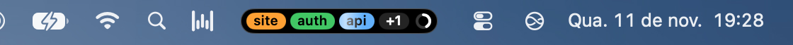
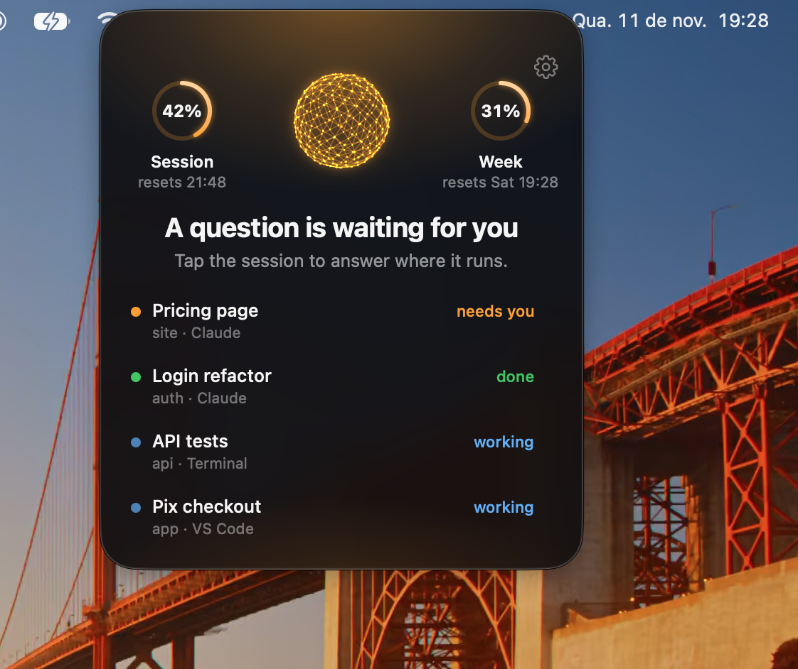
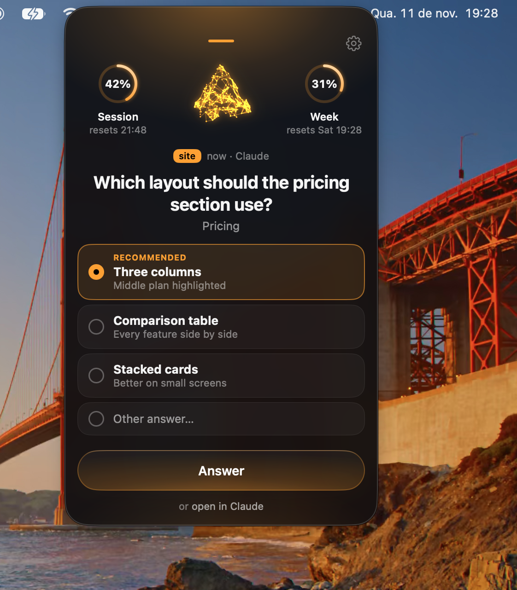
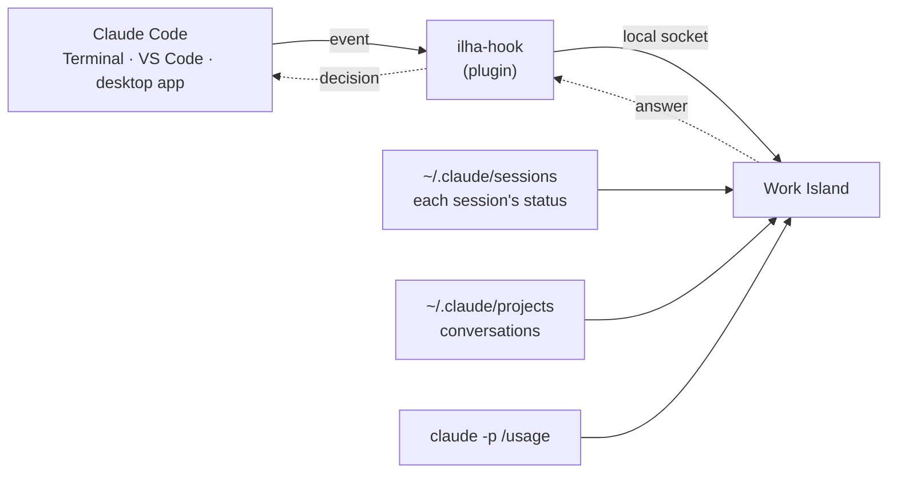

# Work Island

**Work Island · all your Claude Code sessions, one glance away.**

Work Island is a small black island in your Mac's menu bar. It shows your Claude Code sessions: which ones are working, which ones need you, and which ones are done. When Claude asks for a permission or asks you a question, you answer right there, without switching windows. It also shows how much of your plan you've used.

https://github.com/user-attachments/assets/0e607428-7c54-4235-bf92-d93aa134041a

<p align="center">
  
</p>
<p align="center">
  
  &nbsp;
  
</p>

For now, macOS only.

[Leia em português](README.md)

## Why I built it

I work with several Claude Code sessions at once: some in the Claude desktop app, some in VS Code, some in the Terminal. While one works, I move on to another. The hard part is coming back: I kept losing time figuring out which session had stopped to wait for an approval, which one had asked me something, and which one was done. Sometimes a session sat idle for minutes because of an "Allow?" in a window I wasn't looking at.

Then there was the plan limit: I only noticed I was close when I hit it.

There are tools that show sessions in the notch, but none of them lived in the menu bar, showed plan usage and also followed the desktop app. So I built my own: one place, always in sight, that tells me who needs me and lets me answer from there.

## Install

Paste this into the Terminal:

```sh
curl -fsSL https://raw.githubusercontent.com/nickfrance/work-island/main/install.sh | bash
```

The script downloads the latest release, checks its SHA-256, puts `Work Island.app` in `/Applications` (or `~/Applications` if `/Applications` isn't writable) and opens it.

On first launch, the app sets up the rest:

- **The Claude Code plugin.** It adds hooks to Claude Code, so the island sees your sessions start, work and stop, and can hold a permission request or a question until you answer it. Without the plugin, the island still shows your sessions, but you can't answer from it.
- **Open at login.** You can turn it off in Settings.

The plugin only takes effect in new Claude Code sessions. Sessions you opened before show up, but you answer them from the island only after you reopen them.

## Ask Claude

Rather not touch the Terminal? Ask Claude Code to do it. Paste this into a session:

```text
Install Work Island by running: curl -fsSL https://raw.githubusercontent.com/nickfrance/work-island/main/install.sh | bash
```

## Requirements

- macOS 15 or newer (Apple silicon or Intel).
- [Claude Code](https://claude.com/claude-code), in the Terminal, VS Code or the Claude desktop app. The app looks for it in fixed places, not in your `PATH`: `~/.local/bin`, `~/.claude/local`, `/opt/homebrew/bin`, `/usr/local/bin`, or the copy inside the Claude desktop app.

## Uninstall

```sh
curl -fsSL https://raw.githubusercontent.com/nickfrance/work-island/main/uninstall.sh | bash
```

It removes the Claude Code plugin, the login item, the app and its data folder (`~/Library/Application Support/Work Island/`).

## Using it

- **Hover** the island to peek at your sessions and your plan usage. **Click** it to open the card. Click a session to bring its app to the front. **Right-click** a session and choose "Remove from island" to take it off the list. It comes back on its own when it does something new.
- **Answer from the island.** Permissions: "Allow", "Deny", "Deny and explain…" or "Always allow here". Questions: pick one or more options, or type your own answer. Requests that arrive while you answer wait in line. The island holds the request until you answer (7 days at most), and meanwhile the question doesn't show in the original app. To answer there, click "or open in Terminal" (or VS Code, or Claude) and the request goes back to the app the session runs in. Closing the session or the island also hands it back.
- **Keyboard**, with the card open: `1`–`9` pick an option, `↩` confirms, `Esc` denies the permission in focus.
- **Plan usage.** A small ring on the island, and a bigger one at the top of the card: how much of your 5-hour window you've used, when it resets, and your week. White up to 90%, red above, gray when the number is more than 20 minutes old. Work Island reads it by running your own Claude Code (`claude -p /usage`, with hooks and MCP servers off). That doesn't call the model, so it costs 0 tokens. The app never logs in and never reads the Keychain or Claude's credentials.
- **Settings**: the gear in the card, or right-click the island → "Settings…" (⌘,). Open at login, send anonymous usage metrics, hide idle sessions after 6 h, 12 h, 24 h or never, and the plugin status (with "Install again" if something went wrong).
- **Updates.** The island checks GitHub Releases when it opens and every 6 hours. When there's a new version, an arrow shows up on the closed island and a notice in the card. It updates itself, and never restarts while a request is waiting for your answer.
- **Languages**: English and Portuguese (Brazil), following your macOS language.

## How it works

Everything happens on your Mac. The island puts together four sources, all from Claude Code itself:



1. **Events, through the plugin.** The plugin adds a small hook (`ilha-hook`) to 11 Claude Code events: a session started, you sent a prompt, a tool ran, a permission was requested, the turn stopped, the session ended. On every event, the hook sends one line of JSON to the island over a local socket (`~/Library/Application Support/Work Island/ilha.sock`). With the island closed, it exits right away, with no error.
2. **Answers, through the same hook.** For a permission request or a question, the hook waits on the connection. You answer on the island, the answer comes back over the socket, and the hook hands it to Claude Code as its decision. The request waits until you answer, hand it back, or the session ends.
3. **Status, through the registry.** Claude Code keeps one file per session in `~/.claude/sessions/` saying whether it's busy, waiting or idle. The island reads it every 2 seconds. That's how it sees sessions opened before the plugin, and turns whose event got lost.
4. **Title and question, through the conversation.** From the transcript in `~/.claude/projects/`, the island reads only the end: the conversation's title, and whether the turn ended with a question for you. That includes the desktop app's next-step box, where the question isn't in the text.

Plan usage comes from running your own Claude Code (`claude -p /usage`), as described under **Plan usage** above. None of this leaves your Mac. What does is right below.

## What Work Island sends

Release builds send anonymous usage metrics, so I can see whether the island is useful and what to improve. **Nothing from your conversations, folders, commands or account.** Only these seven events, with only these keys:

| Event | Keys | Values |
| --- | --- | --- |
| `ilha_ativa` | `minutos` | Minutes the app was running (Mac awake) on your last active day. Sent once, when the day changes. At most 1440. |
| `cartao_aberto` | `tipo`, `estado` | `tipo`: `espiada` (peek) or `painel` (card). `estado`: `needsYou`, `done`, `working` or `idle`. |
| `cartao_fechado` | `segundos` | How many seconds the peek or card stayed open. |
| `sessao_clicada` | `estado`, `origem` | The session's state (`needsYou`, `done`, `doneStale`, `working` or `idle`), and where it runs: `desktop`, `vscode`, `terminal` or `unknown`. |
| `respondeu_na_ilha` | `pedido`, `resultado` | `pedido`: `permissao` or `pergunta`. `resultado`: `permitiu`, `negou`, `respondeu` or `devolveu` (handed back). |
| `atualizou` | `de`, `para` | The old and new app versions. |
| `configuracao_mudada` | `linha`, `valor` | `linha`: `abrir_ao_ligar`, `metricas` or `adormecer`. `valor`: `true`, `false`, `h6`, `h12`, `h24` or `never`. |

Events wait in a local queue (`~/Library/Application Support/Work Island/metrics-queue.json`, at most 1000) and go out in batches every 15 minutes (only after the "Anonymous metrics on" notice has been shown), as a JSON `POST`:

```json
{
  "v": 1,
  "id": "<random anonymous UUID, created once and kept in settings>",
  "app": "0.3.0",
  "os": "15.6.1",
  "events": [
    { "name": "cartao_aberto", "at": "2026-11-10T14:03:22Z", "props": { "tipo": "painel", "estado": "needsYou" } }
  ]
}
```

The `id` is a random UUID. It isn't tied to you, your Mac or your Claude account. The code that builds every event is in [`Sources/IlhaCore/Metrics.swift`](Sources/IlhaCore/Metrics.swift).

**To turn it off:** Settings → "Send anonymous usage metrics". Turning it off also deletes the local queue. Builds from source never send anything: only builds made with `scripts/release.sh` carry the receiver's address.

Besides metrics, the app only goes online to check GitHub Releases for updates. Plan usage comes from your own Claude Code.

## How it differs

- **Menu bar, not the notch.** It sits with your other menu bar icons, on any Mac and on every screen.
- **Plan usage, always in sight.** The ring tells you how close you are to your limit before you hit it.
- **Every app.** Sessions from the Terminal, VS Code and the Claude desktop app, side by side.
- **Answer from the island.** Permissions and questions, right where you look, without hunting for the right window.

## Build from source

You need macOS 15 or newer and the Command Line Tools for Xcode 26 or newer, with Swift 6.2 (Xcode itself works too, but isn't needed). The app builds against the macOS 26 SDK and runs on macOS 15 or newer.

```sh
scripts/bundle-app.sh          # builds the universal app (and the hook) into build/Work Island.app
open "build/Work Island.app"   # on first launch it installs the plugin bundled inside the app
```

Builds from source don't send metrics.

Builds from source don't update themselves: the island still shows when there's a new version, and "Update" shows the install line, which installs the release build (that one sends anonymous metrics unless you turn them off).

The app reinstalls the plugin when the version in `plugin/.claude-plugin/plugin.json` differs from the installed one. After changing the hook (`Sources/ilha-hook`), bump that version, rebuild and reopen the app. To try the plugin without installing it, use `claude --plugin-dir plugin` (run `scripts/build-plugin.sh` first, so `plugin/bin/ilha-hook` exists).

Tests:

```sh
scripts/test.sh                # unit tests (accepts swift test arguments, e.g. --filter SessionStore)
scripts/test-install.sh        # install.sh and uninstall.sh against a fake local release
scripts/e2e.sh [concluido|permissao|pergunta|tudo]   # end to end with the real Claude Code (haiku, costs a few tokens)
```

With only the Command Line Tools, plain `swift test` can't find the Testing module. `scripts/test.sh` passes the missing flags.

To see the app in English without changing your system language: `open "build/Work Island.app" --args -AppleLanguages '(en)'`. UI text lives in `Sources/IlhaApp/Resources/<language>.lproj`. Every new string goes into both languages.

The hook never gets in Claude Code's way: with the app closed, it exits right away, with no error.

### Debugging

`ILHA_DEBUG=1` turns on two test helpers that are off in normal use:

- `~/Library/Application Support/Work Island/requests.json`: the pending requests (`id`, `sessionID`, `kind`, `title`);
- a socket command to answer without clicking: `{"debugAnswer":"<id>","decision":"allow"|"deny"|"passThrough","message":"…"}`.

```sh
pkill -TERM -x WorkIsland      # quit the normal app
ILHA_DEBUG=1 "build/Work Island.app/Contents/MacOS/WorkIsland" &
printf '{"debugAnswer":"<id>","decision":"allow"}\n' | nc -U "$HOME/Library/Application Support/Work Island/ilha.sock"
```

When you're done, quit the debug app (`pkill -TERM -x WorkIsland`) and reopen the normal one.

## License

[MIT](LICENSE)
