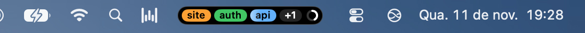
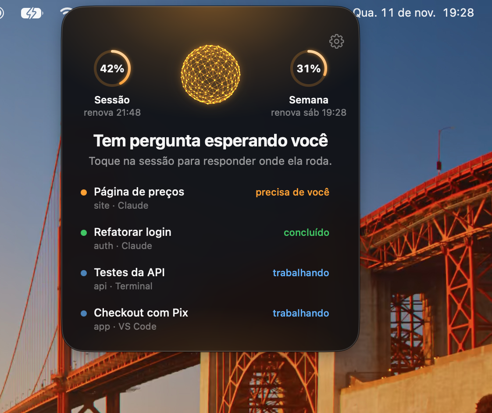
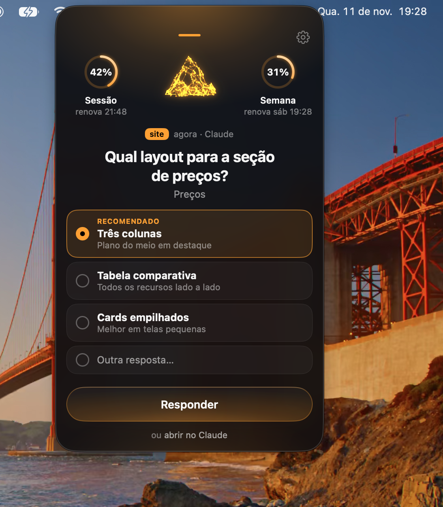
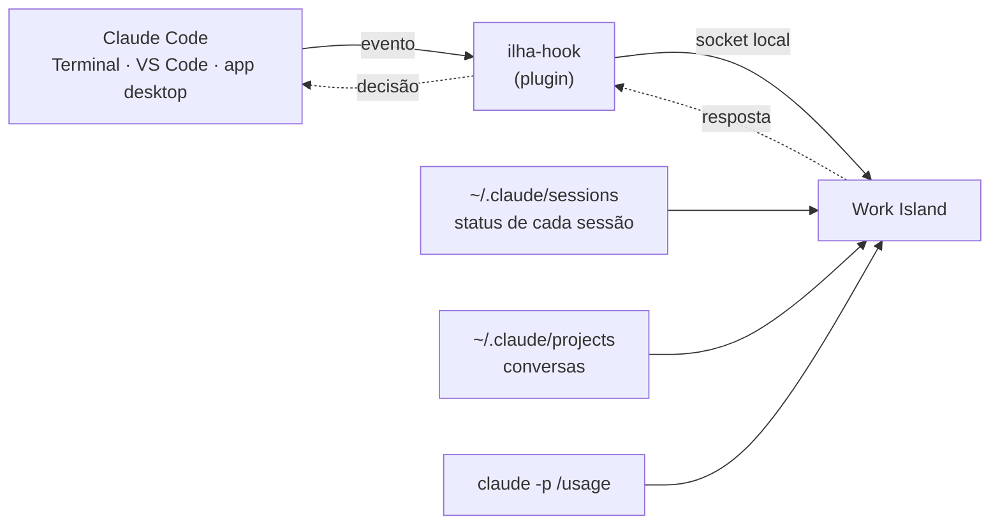

# Work Island

**Work Island · todas as suas sessões do Claude Code, a um olhar de distância.**

A Work Island é uma pequena ilha preta na barra de menu do Mac. Ela mostra as suas sessões do Claude Code: quais estão trabalhando, quais precisam de você e quais já concluíram. Quando o Claude pede uma permissão ou faz uma pergunta, você responde ali mesmo, sem trocar de janela. E ela mostra quanto do seu plano você já usou.

<p align="center">
  
</p>
<p align="center">
  
  &nbsp;
  
</p>

Por enquanto, só para macOS.

[Read in English](README.en.md)

## Por que eu fiz

Eu trabalho com várias sessões do Claude Code ao mesmo tempo: umas no app desktop do Claude, outras no VS Code, outras no Terminal. Enquanto uma trabalha, eu sigo em outra. O problema é voltar: eu perdia tempo descobrindo qual sessão tinha parado esperando uma aprovação, qual tinha feito uma pergunta e qual já tinha terminado. Às vezes uma ficava minutos parada por causa de um "Permitir?" numa janela que eu não estava olhando.

E tinha o limite do plano: eu só via que estava perto quando batia nele.

Já existem ferramentas que mostram sessões no notch, mas nenhuma ficava na barra de menu, mostrava o uso do plano e acompanhava também o app desktop. Então eu fiz a minha: um lugar só, sempre à vista, que diz quem precisa de mim e me deixa responder dali.

## Instalar

Cole no Terminal:

```sh
curl -fsSL https://raw.githubusercontent.com/nickfrance/work-island/main/install.sh | bash
```

O script baixa a última versão, confere o SHA-256, coloca o `Work Island.app` em `/Applications` (ou em `~/Applications`, se não der para gravar em `/Applications`) e abre o app.

Na primeira abertura, o app cuida do resto:

- **O plugin do Claude Code.** Ele liga hooks no Claude Code, para a ilha ver as sessões começarem, trabalharem e pararem, e para segurar um pedido de permissão ou uma pergunta até você responder. Sem o plugin, a ilha ainda mostra as sessões, mas não dá para responder por ela.
- **Abrir ao ligar o Mac.** Dá para desligar nas configurações.

O plugin só vale para novas sessões do Claude Code. As sessões abertas antes aparecem, mas só respondem pela ilha depois de reabertas.

## Peça ao Claude

Prefere não mexer no Terminal? Peça ao Claude Code. Cole isto numa sessão:

```text
Instale a Work Island rodando: curl -fsSL https://raw.githubusercontent.com/nickfrance/work-island/main/install.sh | bash
```

## Requisitos

- macOS 15 ou mais novo (Apple silicon ou Intel).
- [Claude Code](https://claude.com/claude-code), no Terminal, no VS Code ou no app desktop do Claude. O app o procura em lugares fixos, não no `PATH`: `~/.local/bin`, `~/.claude/local`, `/opt/homebrew/bin`, `/usr/local/bin` ou a cópia que vem dentro do app desktop do Claude.

## Desinstalar

```sh
curl -fsSL https://raw.githubusercontent.com/nickfrance/work-island/main/uninstall.sh | bash
```

Remove o plugin do Claude Code, o item de início, o app e a pasta de dados (`~/Library/Application Support/Work Island/`).

## Como usar

Passe o mouse na ilha para ver a espiada, com as sessões e o uso do plano. Clique para abrir o painel. Clique numa sessão para trazer o app dela para a frente. Clique com o botão direito numa sessão e escolha "Remover da ilha" para tirá-la da lista. Ela volta sozinha quando fizer algo novo.

As configurações ficam na engrenagem do painel, ou no clique direito na ilha → "Configurações…" (⌘,): abrir ao ligar o Mac, enviar métricas de uso anônimas, tirar da ilha sessões paradas há 6 h, 12 h, 24 h ou nunca, e o estado do plugin (com "Instalar de novo", se algo deu errado).

Idiomas: português (padrão) e inglês, escolhidos pelo idioma do macOS, inclusive nos cartões, nas horas e nas datas.

### Responder pela ilha

Quando o Claude Code precisa de uma permissão ou faz uma pergunta, a ilha avisa ("N esperando você · clique para responder") e você responde ali, sem trocar de janela. O plugin segura o pedido (hooks `PermissionRequest` e, para a ferramenta de perguntas, `PreToolUse`) e espera a resposta do app.

Uma permissão aparece no app de origem e na ilha ao mesmo tempo, e vale quem responder primeiro. Uma pergunta que a ilha segura some do app de origem até a ilha responder ou devolver.

O que dá para responder:

- **Permissões** (rodar um comando, editar um arquivo, abrir um domínio, usar uma ferramenta): "Permitir", "Negar", "Negar e explicar…" (você diz ao Claude o que fazer em vez disso) e "Sempre permitir aqui" (grava a regra que o Claude Code sugere, só para este projeto). Pedidos que mexem fora do Mac ganham o aviso "Mexe fora do Mac".
- **Perguntas**: escolha única, múltipla ("Escolha quantas quiser.") e "Outra resposta…", onde você digita a sua. Pergunta com várias etapas aparece uma por vez ("1 de 2"), e as longas ganham "ver pergunta inteira".
- **Vários pedidos em sequência**: o que chega enquanto você responde entra na fila ("Na fila", "Pedido 2 de 3"); ao responder um, o próximo desliza para o lugar.

Como a ilha se comporta: com um pedido esperando, ela cresce e muda para "precisa de você". Passar o mouse mostra a espiada; clicar abre o painel com o cartão; ao terminar, ela volta ao tamanho de antes. Se o app da sessão (Terminal, VS Code, app desktop do Claude...) está na frente quando o pedido chega, o painel abre sozinho no cartão, para você não achar que a sessão travou; o teclado continua no app em que você está até você clicar na ilha.

Teclado, com o painel aberto e fora do campo de texto: `1`–`9` escolhem a opção da pergunta (depois da última vem "Outra resposta…"); `↩` confirma ("Permitir" numa permissão, "Enviar" ou "Próxima" numa pergunta; dentro do campo de texto o `↩` também envia e `⇧↩` quebra a linha); `Esc` nega a permissão em foco (numa pergunta só fecha o painel; com o cursor num campo de texto só tira o foco). Tecla segurada nunca responde nada.

A ilha segura o pedido até você responder (no limite, 7 dias). Enquanto isso, a pergunta não aparece no app de origem. Para responder lá, clique em "ou abrir no Terminal" (o nome muda conforme o app: VS Code, Claude...): o pedido volta para o app onde a sessão roda, e o cartão mostra "Voltou para o Terminal". Fechar a sessão ou a ilha também devolve o pedido. Respondendo no app de origem antes da ilha, o cartão da ilha some com "Já respondido no Terminal".

### Uso do plano

A ilha mostra quanto você já gastou da janela de 5 h do seu plano: um anel pequeno dentro da ilha, depois das etiquetas, e um maior no topo da espiada, com "Sessão X%" e "renova 17:30 · semana Y%" (hora local, no formato do sistema). O número vem só do próprio Claude Code: o app roda `claude -p /usage` (o Claude Code instalado, num dos lugares citados em Requisitos), com os hooks e os servidores MCP desligados, e por isso essa leitura nunca aparece como sessão. Ela não chama o modelo, então custa 0 tokens; cada leitura leva cerca de 4 s (mais em máquina carregada; o limite é 60 s). A ilha nunca faz login, nunca lê o Chaves nem arquivos de credencial. O último resultado fica em `~/Library/Application Support/Work Island/usage.json`.

Quando lê:

- ao abrir o app;
- depois que o turno de uma sessão que você está acompanhando termina, no máximo uma vez a cada 2 min;
- ao abrir a espiada ou o painel, se a última tentativa tem mais de 1 min;
- a cada 15 min, com tudo parado;
- na renovação da janela de 5 h (+5 s).

Enquanto não houve nenhuma leitura boa, uma falha tenta de novo em 2 min. Tela apagada ou bloqueada pausa todas as leituras. O modo de pouca energia só pula a leitura parada de 15 min: abrir o app, fim de turno, abrir a espiada e a renovação continuam lendo.

O que o anel significa:

- branco: até 90% da janela;
- vermelho: acima de 90%;
- cinza: a última leitura boa tem mais de 20 min ("atualizado há N min"), então o número pode estar velho;
- cinza vazio: ainda sem número, com "lendo o uso…", "não consegui ler o uso" ou "Claude Code não encontrado";
- sem anel: conta sem limite de plano ("conta sem limite de plano").

### Atualizações

A ilha procura uma versão nova nas Releases do GitHub ao abrir e a cada 6 h. Quando há, aparece uma seta na ilha fechada e um aviso no painel. Ela se atualiza sozinha e nunca reinicia enquanto um pedido espera a sua resposta.

## Como funciona

Tudo acontece no seu Mac. A ilha junta quatro fontes, todas do próprio Claude Code:



1. **Os eventos, pelo plugin.** O plugin liga um hook pequeno (`ilha-hook`) em 11 eventos do Claude Code: a sessão começou, você mandou um prompt, uma ferramenta rodou, pediu permissão, parou, terminou. A cada evento, o hook manda uma linha de JSON para a ilha por um socket local (`~/Library/Application Support/Work Island/ilha.sock`). Com a ilha fechada, ele sai na hora, sem erro.
2. **As respostas, pelo mesmo hook.** Num pedido de permissão ou numa pergunta, o hook espera na conexão. Você responde na ilha, a resposta volta pelo socket e o hook a entrega ao Claude Code como decisão. O pedido espera até você responder, devolver ou a sessão acabar.
3. **O status, pelo registro.** O Claude Code mantém um arquivo por sessão em `~/.claude/sessions/` dizendo se ela está ocupada, esperando ou ociosa. A ilha lê esse registro a cada 2 s. É assim que ela vê sessões abertas antes do plugin, e turnos cujo evento se perdeu.
4. **Título e pergunta, pela conversa.** Da transcrição em `~/.claude/projects/`, a ilha lê só o final: o título da conversa e se o turno terminou com uma pergunta para você. Isso inclui a caixa de próximo passo do app desktop, onde a pergunta não aparece no texto.

O uso do plano vem de rodar o seu Claude Code (`claude -p /usage`), como explicado em [Uso do plano](#uso-do-plano). Nada disso sai do Mac. O que sai está logo abaixo.

## O que a Work Island envia

As versões publicadas enviam métricas de uso anônimas, para eu saber se a ilha está sendo útil e o que melhorar. **Nada das suas conversas, pastas, comandos ou conta.** Só estes sete eventos, só com estas chaves:

| Evento | Chaves | Valores |
| --- | --- | --- |
| `ilha_ativa` | `minutos` | Minutos com o app aberto (Mac acordado) no último dia de uso. Sai uma vez, quando o dia vira. No máximo 1440. |
| `cartao_aberto` | `tipo`, `estado` | `tipo`: `espiada` ou `painel`. `estado`: `needsYou`, `done`, `working` ou `idle`. |
| `cartao_fechado` | `segundos` | Quantos segundos a espiada ou o painel ficou aberto. |
| `sessao_clicada` | `estado`, `origem` | O estado da sessão (`needsYou`, `done`, `doneStale`, `working` ou `idle`) e onde ela roda: `desktop`, `vscode`, `terminal` ou `unknown`. |
| `respondeu_na_ilha` | `pedido`, `resultado` | `pedido`: `permissao` ou `pergunta`. `resultado`: `permitiu`, `negou`, `respondeu` ou `devolveu`. |
| `atualizou` | `de`, `para` | A versão antiga e a nova do app. |
| `configuracao_mudada` | `linha`, `valor` | `linha`: `abrir_ao_ligar`, `metricas` ou `adormecer`. `valor`: `true`, `false`, `h6`, `h12`, `h24` ou `never`. |

Os eventos esperam numa fila local (`~/Library/Application Support/Work Island/metrics-queue.json`, no máximo 1000) e saem em lotes a cada 15 min (só depois de o aviso "Métricas anônimas ligadas" aparecer), num `POST` JSON:

```json
{
  "v": 1,
  "id": "<UUID anônimo aleatório, criado uma vez e guardado nas preferências>",
  "app": "0.3.0",
  "os": "15.6.1",
  "events": [
    { "name": "cartao_aberto", "at": "2026-11-10T14:03:22Z", "props": { "tipo": "painel", "estado": "needsYou" } }
  ]
}
```

O `id` é um UUID aleatório. Ele não está ligado a você, ao seu Mac nem à sua conta do Claude. O código que monta cada evento está em [`Sources/IlhaCore/Metrics.swift`](Sources/IlhaCore/Metrics.swift).

**Para desligar:** Configurações → "Enviar métricas de uso anônimas". Desligar também apaga a fila local. Versões compiladas a partir do código nunca enviam nada: só as montadas pelo `scripts/release.sh` levam o endereço do receptor.

Fora as métricas, o app só acessa a internet para procurar atualizações nas Releases do GitHub. O uso do plano vem do seu próprio Claude Code.

## No que ela é diferente

- **Barra de menu, não o notch.** Fica junto dos outros ícones da barra, em qualquer Mac e em todas as telas.
- **Uso do plano sempre à vista.** O anel mostra quanto falta para o limite antes de você bater nele.
- **Todos os apps.** Sessões do Terminal, do VS Code e do app desktop do Claude, lado a lado.
- **Responder pela ilha.** Permissões e perguntas onde você já está olhando, sem caçar a janela certa.

## Compilar a partir do código

Precisa de macOS 15 ou mais novo e das Command Line Tools for Xcode 26 ou mais novo, com Swift 6.2 (`swift-tools-version: 6.2`). O Xcode 26 também serve, mas não é necessário. O app compila contra o SDK do macOS 26, mas roda no macOS 15 ou mais novo.

```sh
scripts/bundle-app.sh          # compila o app universal (e o hook) e monta build/Work Island.app
open "build/Work Island.app"   # na primeira abertura, instala o plugin que vem dentro do app
```

Versões compiladas a partir do código não enviam métricas.

Versões compiladas a partir do código não se atualizam sozinhas: a ilha ainda avisa quando há versão nova, e o "Atualizar" mostra a linha de instalação, que instala a versão publicada (essa envia métricas anônimas, a não ser que você as desligue).

O app reinstala o plugin quando a versão em `plugin/.claude-plugin/plugin.json` é diferente da instalada. Depois de mexer no hook (`Sources/ilha-hook`), suba essa versão, recompile e reabra o app. Para testar o plugin sem instalar, use `claude --plugin-dir plugin` (rode antes o `scripts/build-plugin.sh`, para existir o `plugin/bin/ilha-hook`).

O hook nunca atrapalha o Claude Code: com o app fechado ele sai sem erro e sem atraso perceptível.

Para ver em inglês sem mudar o sistema: `open "build/Work Island.app" --args -AppleLanguages '(en)'`. Os textos ficam em `Sources/IlhaApp/Resources/<idioma>.lproj` (todo texto novo entra nos dois).

Para fechar o app, clique com o botão direito na ilha (ou Control-clique) e escolha "Sair da Work Island". Pelo terminal, `pkill -TERM -x WorkIsland` também fecha de forma limpa (o socket é removido).

### Testes

```sh
scripts/test.sh                # testes de unidade (aceita os argumentos do swift test, ex.: --filter SessionStore)
scripts/test-install.sh        # install.sh e uninstall.sh contra uma release falsa local
```

Só com as Command Line Tools, sem Xcode, o `swift test` puro não acha o módulo Testing; o script passa as flags que faltam.

### Teste ponta a ponta

```sh
scripts/e2e.sh              # concluído (padrão)
scripts/e2e.sh permissao    # permitir e negar pela ilha
scripts/e2e.sh pergunta     # responder e devolver uma pergunta pela ilha
scripts/e2e.sh tudo         # todos
```

**Concluído:** com o app aberto, roda `claude -p "Responda só: ok" --model haiku` numa pasta temporária, carregando o plugin só para essa chamada (`--plugin-dir`, sem instalar nada), e confere em `~/Library/Application Support/Work Island/state.json` que a sessão apareceu como concluída. Como o `claude -p` encerra a sessão (e a ilha a remove) logo depois do Stop, essa chamada, e só ela (via `--settings`), ganha um hook de Stop extra que espera 4 s, tempo para conferir o "concluído".

**Permissão:** exige o app aberto com `ILHA_DEBUG=1` (veja "Para desenvolver"). Roda duas vezes `claude -p` (haiku, `--permission-mode default`, só a ferramenta Bash, no máximo 4 turnos, pasta temporária, `--plugin-dir`) pedindo `echo oi > teste.txt` com o Bash. O script espera os pedidos aparecerem em `requests.json` (se o modelo tentar de novo depois de uma negativa, responde todos do mesmo jeito), responde "permitir" pelo comando de teste e confere que `teste.txt` existe com `oi`; na segunda rodada responde "negar" com um motivo e confere que o arquivo não foi criado. Cada rodada leva cerca de 10 s; o teto de espera é 120 s.

**Pergunta:** também exige `ILHA_DEBUG=1`. No `claude -p` comum a ferramenta de perguntas (AskUserQuestion) não existe, então o script roda o Claude Code no modo do Agent SDK (entrada e saída stream-json, `--permission-prompt-tool stdio`, só AskUserQuestion, sem servidores MCP, haiku, no máximo 4 turnos), pedindo uma pergunta com as opções "Manga" e "Uva". Na primeira rodada responde "Uva" pelo comando de teste e confere que o Claude responde "Uva". Na segunda devolve a pergunta ao app de origem e confere que, nos 3 s seguintes, a ilha não segura um pedido de permissão da mesma sessão (o Claude Code manda um `PermissionRequest` da própria pergunta logo depois; o script, no papel do app de origem, o nega).

Sai com 0 se passou, 1 se falhou e 2 se o app não está aberto (ou não está em `ILHA_DEBUG=1` quando o caso pede). Custa alguns tokens do seu plano.

### Para desenvolver

`ILHA_DEBUG=1` liga dois recursos de teste, desligados no uso normal:

- `~/Library/Application Support/Work Island/requests.json`: os pedidos pendentes (`id`, `sessionID`, `kind`, `title`);
- um comando no socket para responder sem clicar: `{"debugAnswer":"<id>","decision":"allow"|"deny"|"passThrough","message":"…"}`.

```sh
pkill -TERM -x WorkIsland      # feche a instância normal
ILHA_DEBUG=1 "build/Work Island.app/Contents/MacOS/WorkIsland" &
printf '{"debugAnswer":"<id>","decision":"allow"}\n' | nc -U "$HOME/Library/Application Support/Work Island/ilha.sock"
```

Quando terminar, feche o app de debug (`pkill -TERM -x WorkIsland`) e reabra o normal com `open "build/Work Island.app"`.

## Licença

[MIT](LICENSE)
